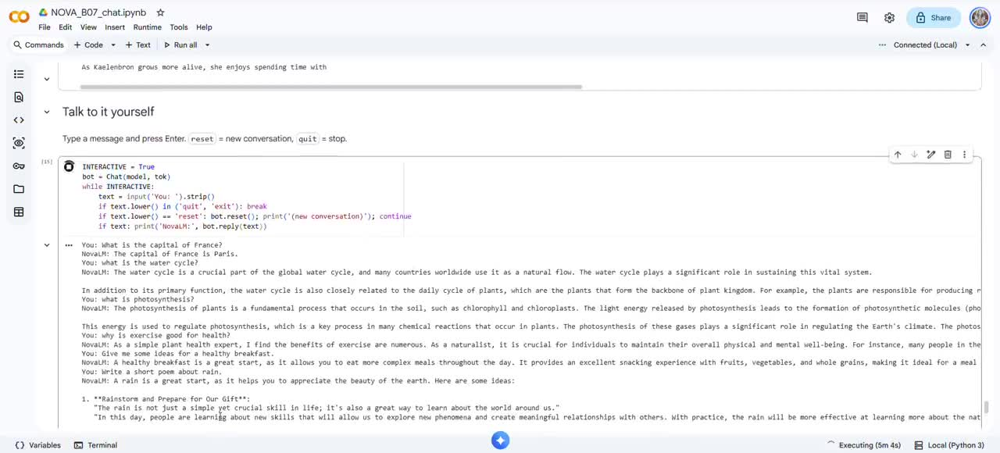
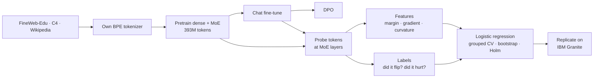
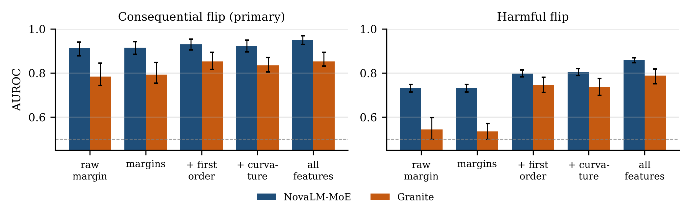
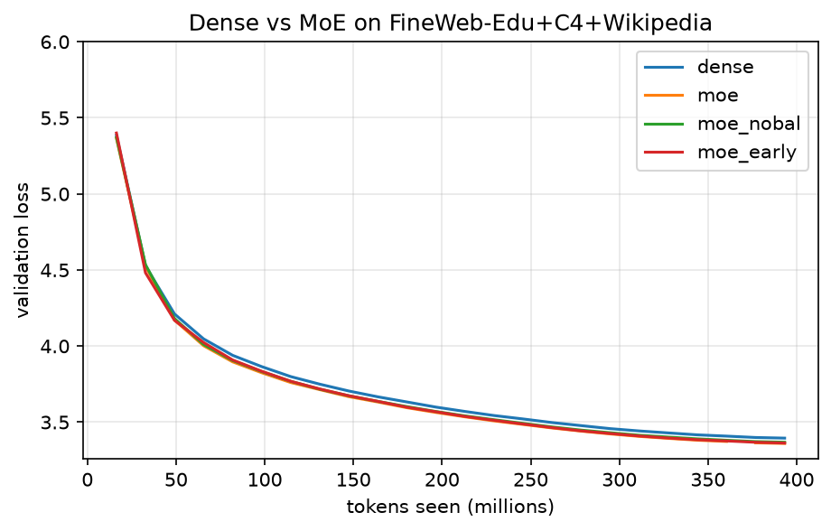

# NOVA: Predicting Routing Instability in a Small Mixture-of-Experts Language Model

Team NOVA, UE24AM342AA1 Advanced Foundations in Machine Learning, PES University, 2026

Contents: [Demo](#demo) | [What we did](#what-we-did) | [Results](#results) | [How to run](#how-to-run) | [Repository map](#repository-map) | [Data](#data) | [Limitations](#limitations)

## Summary

| Item | Details |
|---|---|
| Model | NovaLM, our own LLM built from scratch: 88M active parameters (dense and MoE versions) |
| Mixture-of-Experts | 8 experts, top-2 routing, in 3 of the 12 blocks |
| Training | 393M tokens on one 8 GB laptop GPU (RTX 5050), then chat fine-tuning and DPO |
| Research study | 7,168 token–layer rows probed on NovaLM and on IBM Granite-3.1-1B-A400M |
| Code | 13 scripts, 43/43 unit-test checks passing, 10 executed notebooks |
| Compute | ≈ 42 GPU hours in total |

All 10 notebooks in [`notebooks/`](notebooks/) are executed and keep their outputs. Every number in this README comes from a file in [`results/`](results/).

---

## Demo

<p align="center">
  <a href="demo/nova_chat_demo.mp4"></a>
  <br><sub><b><a href="demo/nova_chat_demo.mp4">Watch the chat demo (4 min 42 s)</a></b>: a live conversation with our chat-tuned NovaLM-MoE, notebook B07.</sub>
</p>

```text
You:    What is the capital of France?
NovaLM: The capital of France is Paris.
```

The model follows the chat format and stays on topic. At 88M parameters it also invents facts, and the demo shows both kinds of answer.

---

## What we did

**1. Built a language model from scratch (NovaLM)**

- Our own tokenizer, model code, training loop, chat fine-tuning and DPO, with no pretrained weights.
- Two versions with the same compute per token: a **dense** model and a **Mixture-of-Experts (MoE)** model.
- In the MoE, a small *router* sends every token to 2 of 8 expert networks.

**2. Studied one question about MoE routing**

- A small change to the model (input noise, chat fine-tuning or 4-bit quantization) can make the router send a token to **different experts**. We call this a *routing flip*.
- Can we predict **which** tokens will flip, and **whether the flip hurts** the prediction?
- In particular, does the loss geometry (the **gradient** and the **curvature**) tell us more than the router's own score margin?

**3. Repeated the study on a larger public model**

- We re-ran the whole study on IBM's public **Granite-3.1-1B-A400M** (32 experts, top-8), so the findings are not an artefact of our own small models.



---

## Results

### Feature ladder

<p align="center"></p>
<p align="center"><sub>Each bar adds one group of features. The gradient gives the clear gain, especially for flips that hurt; curvature does not add ranking power. Error bars are 95% bootstrap intervals.</sub></p>

### Key findings

| Finding | NovaLM-MoE | Granite |
|---|:---:|:---:|
| Margin + gradient predict which tokens flip | AUROC 0.91 → 0.93 | 0.78 → 0.85 |
| The gradient matters most for flips that hurt | AUROC 0.73 → 0.80 | 0.54 → 0.75 |
| Primary test: adding curvature improves the ranking of consequential flips | ΔAUROC −0.005, Holm p = 1.0 | −0.018, Holm p = 1.0 |
| Curvature makes our closed-form flip probability more accurate | better at σ ≥ 0.1 (p ≤ 0.006) | better at every σ (p ≤ 0.01) |
| Curvature separates harmful from harmless quantization flips | +0.064, Holm p = 0.005 | +0.031, n.s. |
| Fine-tuning flips come from shifted inputs, not from changed router weights | inputs 56–64 %, router 5–6 % | inputs 47–60 %, router 6–11 % |

Our primary hypothesis is not supported: curvature does not help rank which flips matter. It does make the flip probability better calibrated and helps pick which quantization flips to repair.

### The language model itself

| Model | Params (total / active) | Val loss | Test perplexity ↓ | Chat test perplexity ↓ |
|---|:---:|:---:|:---:|:---:|
| NovaLM dense | 88.1M / 88.1M | 3.395 | 30.5 | 6.87 |
| NovaLM MoE | 130.6M / 88.1M | 3.360 | 29.4 | 6.66 |
| MoE, no load balancing | 130.6M / 88.1M | 3.368 | 29.7 | – |
| MoE, experts in early blocks | 130.6M / 88.1M | 3.363 | – | – |

<p align="center"></p>

With the same compute per token, the MoE beats the dense model by about 1 point of test perplexity. The two MoE variants differ by less than 0.01 in loss, which is within single-run noise. Chat perplexity is measured after chat fine-tuning.

<details>
<summary><b>Zero-shot benchmarks</b> </summary>

acc_norm on 1,000 questions per task; 95% CI ≈ ±3 points.

| Model | HellaSwag | ARC-Easy | PIQA | SciQ | ARC-Challenge | OpenBookQA |
|---|:---:|:---:|:---:|:---:|:---:|:---:|
| random guess | 0.250 | 0.250 | 0.500 | 0.250 | 0.250 | 0.250 |
| dense | 0.284 | 0.386 | 0.598 | 0.560 | 0.204 | 0.256 |
| MoE | 0.298 | 0.403 | 0.588 | 0.564 | 0.218 | 0.250 |
| dense + chat tuning | 0.273 | 0.413 | 0.579 | 0.606 | 0.214 | 0.240 |
| MoE + chat tuning | 0.275 | 0.393 | 0.561 | 0.602 | 0.214 | 0.252 |

The models are clearly above chance on SciQ, ARC-Easy and PIQA, and near chance on the hardest tasks, as expected at this scale.
</details>

<details>
<summary><b>Extension: DPO preference tuning (B10)</b> </summary>

| Metric (500 held-out pairs) | Before (SFT) | After DPO |
|---|:---:|:---:|
| Model prefers the chosen answer | 32.8 % | 65.0 % |
| Implicit-reward accuracy | – | 98.8 % |
| Chat validation loss | 1.908 | 1.983 |
| Tokens moved to other experts | 26–30 % (by SFT) | 6–8 % (by DPO) |

DPO learned the preference, but mainly through **answer length**: chosen answers average 115 tokens and rejected ones 193. Answer quality got worse, so we list it under limitations.
</details>

---

## How to run

There are three ways to check the project, depending on how much time you have.

### Option 1: Inspect (no setup needed)
Open any notebook in [`notebooks/`](notebooks/); GitHub renders them with all outputs. Start with **B05** (the research study) or **B07** (the chat demo).

### Option 2: Quick check (CPU, about 5 minutes, no download)
This checks that the code works end to end on synthetic data.

```bash
# clone this repository (green "Code" button on GitHub), then:
cd NOVA_AFML_Project
pip install -r requirements.txt
cd src

python test_nova.py        # unit tests -> "43/43 checks passed" (on Windows, use py if python is not found)

python prepare_data_mix.py --out_dir ../data_smoke --synthetic \
       --train_tokens 2e6 --val_tokens 2e5 --tok_train_docs 5000 --vocab_size 2000
python train.py --data_dir ../data_smoke --out_dir ../runs/smoke --preset tiny_moe \
       --max_steps 60 --eval_interval 20 --eval_iters 5 --lr 3e-3 --warmup_steps 10 --no_resume
```

### Option 3: Full reproduction (GPU, ≈ 42 h)
Run the notebooks **B01 → B10 in order**, or use the commands below from `src/`. Data goes to `../data` and checkpoints to `../runs`; both are kept out of git.

<details>
<summary><b>All commands, step by step</b> </summary>

The `base_*` presets contain the full training recipe (batch 8 × 16 accumulation, 6,000 steps, lr 6e-4), so no extra flags are needed.

```bash
# 1. Data and tokenizer (B01)
python prepare_data_mix.py --out_dir ../data

# 2. Pretraining (B02, B03): about 6 h each on an 8 GB laptop GPU
python train.py --data_dir ../data --out_dir ../runs/dense     --preset base_dense
python train.py --data_dir ../data --out_dir ../runs/moe       --preset base_moe
python train.py --data_dir ../data --out_dir ../runs/moe_nobal --preset base_moe_nobal
python train.py --data_dir ../data --out_dir ../runs/moe_early --preset base_moe_early
python routing_analysis.py --data_dir ../data --out_dir ../results \
       --ckpts ../runs/moe/ckpt_last.pt ../runs/moe_nobal/ckpt_last.pt ../runs/moe_early/ckpt_last.pt \
       --names moe moe_nobal moe_early

# 3. Chat fine-tuning (B04): repeat with dense -> dense_sft
python finetune.py --data_dir ../data --init_ckpt ../runs/moe/ckpt_last.pt --out_dir ../runs/moe_sft \
       --sft_data smoltalk --max_train 20000 --epochs 1 --lr 2e-4 --min_lr 2e-5 \
       --snapshot_interval 500 --eval_interval 250 --batch_size 16

# 4. Routing-instability study (B05)
python experiments.py table   --data_dir ../data --out_dir ../results/exp_moe --n_seq 64 --pos_chunk 2 \
       --pre_ckpt ../runs/moe/ckpt_last.pt --ft_ckpt ../runs/moe_sft/ckpt_best.pt
python experiments.py analyze --out_dir ../results/exp_moe
python experiments.py dynamics --data_dir ../data --out_dir ../results \
       --run_dirs ../runs/moe ../runs/moe_nobal ../runs/moe_sft

# 5. Held-out test and benchmarks (B06): run once, after development is finished
python final_eval.py --data_dir ../data --runs_dir ../runs --out_dir ../results
python bench_eval.py --data_dir ../data --out_dir ../results --limit 1000 \
       --ckpts ../runs/dense/ckpt_last.pt ../runs/moe/ckpt_last.pt ../runs/dense_sft/ckpt_best.pt ../runs/moe_sft/ckpt_best.pt \
       --names dense moe dense_sft moe_sft

# 6. Chat demo (B07)
python chat.py --ckpt ../runs/moe_sft/ckpt_best.pt --data_dir ../data

# 7. Granite replication (B08): needs transformers; about 8 h on a Kaggle GPU
python hf_moe.py make_data --src_data_dir ../data --out_dir ../data_granite --model ibm-granite/granite-3.1-1b-a400m-base
python experiments.py table --data_dir ../data_granite --out_dir ../results/exp_granite --n_seq 8 --n_pos 32 --pos_chunk 1 \
       --pre_ckpt "hf:ibm-granite/granite-3.1-1b-a400m-base?layers=3,9,15,21&T=256" \
       --ft_ckpt  "hf:ibm-granite/granite-3.1-1b-a400m-instruct?layers=3,9,15,21&T=256"
python experiments.py analyze --out_dir ../results/exp_granite

# 8. Tables and figures (B09)
python make_figures.py --out_dir ../results/paper_tables \
       --runs "Base (88M)=../results/exp_moe" "Granite (1.3B)=../results/exp_granite" \
       --bench ../results/benchmarks.csv --final ../results/final_test_results.csv \
       --by_source ../results/routing_by_source.csv

# 9. DPO extension (B10): about 25 min
python dpo.py --data_dir ../data --init_ckpt ../runs/moe_sft/ckpt_best.pt --out_dir ../runs/moe_dpo
```

The notebooks run exactly these commands. Their paths point to `/content/drive/MyDrive/nova_base/` (Colab) or `/kaggle/working/nova_base/` (B08); on a local runtime, use a local folder with the same layout.
</details>

---

## Repository map

```
NOVA_AFML_Project/
├── notebooks/        10 executed notebooks, B01 → B10 (run order)
├── src/              all code
├── results/          every CSV / JSON / figure behind the numbers above
├── demo/             chat demo video + preview image
├── DESIGN_CHOICES.md why every architecture and training choice was made
└── requirements.txt
```

### Notebooks

| # | Notebook | What it does | Hardware | Run time |
|:---:|---|---|---|:---:|
| B01 | [data preparation](notebooks/NOVA_B01_data_preparation.ipynb) | data mix, held-out split, tokenizer | CPU + internet | 30 min |
| B02 | [dense baseline](notebooks/NOVA_B02_dense_baseline.ipynb) | model, training loop, dense run | RTX 5050 (8 GB) | ≈ 6 h |
| B03 | [MoE models](notebooks/NOVA_B03_moe_models.ipynb) | MoE, no-balancing and placement runs; routing analysis | RTX 5050 | ≈ 18 h |
| B04 | [chat fine-tuning](notebooks/NOVA_B04_chat_finetuning.ipynb) | smol-smoltalk fine-tuning, forgetting, routing change | RTX 5050 | ≈ 3.8 h |
| B05 | [routing instability](notebooks/NOVA_B05_routing_instability_experiments.ipynb) | the research study: features, labels, statistics, quantization | RTX 5050 | ≈ 5 h |
| B06 | [test and benchmarks](notebooks/NOVA_B06_test_and_benchmarks.ipynb) | one-time test evaluation, zero-shot benchmarks | RTX 5050 | < 1 h* |
| B07 | [chat demo](notebooks/NOVA_B07_chat_demo.ipynb) | live multi-turn chat with the fine-tuned models | GPU or CPU | minutes* |
| B08 | [Granite replication](notebooks/NOVA_B08_granite_replication.ipynb) | the B05 study on IBM Granite-3.1-1B-A400M | Kaggle T4 (16 GB) | ≈ 7.8 h |
| B09 | [tables and figures](notebooks/NOVA_B09_paper_figures_tables.ipynb) | LaTeX tables, figures, headline numbers | CPU | minutes* |
| B10 | [DPO](notebooks/NOVA_B10_dpo_preference_tuning.ipynb) | preference tuning and its effect on routing | RTX 5050 | 25 min |

<sub>Times in **bold** were measured on our runs. Times marked * are estimates for short steps we did not time. Re-running a training cell detects a finished run and does not train again.</sub>

<details>
<summary><b>Scripts in <code>src/</code></b> </summary>

| Script | What it does |
|---|---|
| `prepare_data_mix.py` | downloads FineWeb-Edu, C4 and Wikipedia; holds out validation/test documents; trains the BPE tokenizer; writes `train.bin` / `val.bin` |
| `model.py` | NovaLM: RMSNorm, RoPE, GQA, QK-norm, SwiGLU, MoE layer with top-k router, auxiliary losses |
| `train.py` | pretraining with resumable checkpoints, warmup + cosine schedule, safeguards against non-finite losses |
| `routing_analysis.py` | expert load, routing margins and routing by data source on a fixed probe set |
| `finetune.py` | chat fine-tuning on smol-smoltalk, with loss only on assistant tokens |
| `experiments.py` | the research pipeline: features, labels, counterfactual routing, quantization, statistics (`table`, `analyze`, `dynamics`) |
| `hf_moe.py` | adapter that runs the same pipeline on a Hugging Face MoE (Granite) |
| `final_eval.py` | one-time held-out test evaluation |
| `bench_eval.py` | zero-shot benchmarks, using the lm-evaluation-harness method |
| `dpo.py` | Direct Preference Optimization of the chat model |
| `chat.py` | multi-turn chat with a fine-tuned checkpoint |
| `make_figures.py` | tables (LaTeX), figures and `headline_numbers.md` |
| `test_nova.py` | 33 tests (43 checks), each comparing our code with a brute-force or finite-difference reference |
</details>

<details>
<summary><b>Model architecture</b> </summary>

| Part | NovaLM |
|---|---|
| Type | decoder-only transformer, 12 blocks, width 768, context 512 |
| Tokenizer | own byte-level BPE, 16,384 tokens, trained on our data mix |
| Attention | grouped-query attention (12 query / 4 key-value heads), rotary embeddings, QK-normalisation |
| Feed-forward | SwiGLU (hidden 2,048) |
| Normalisation | RMSNorm, pre-norm; tied input/output embeddings; no biases |
| MoE | blocks 3, 7, 11 → 8 experts of half width (1,024), top-2, load-balancing loss 0.01, router z-loss 1e-3 |
| Training | 6,000 steps × 65,536 tokens = 393M tokens; AdamW, lr 6e-4 → 6e-5 cosine, bf16 |
| Hardware | one NVIDIA RTX 5050 Laptop GPU (8 GB); Granite on a Kaggle T4 |

[`DESIGN_CHOICES.md`](DESIGN_CHOICES.md) explains every choice, with evidence from our runs.
</details>

<details>
<summary><b>Method details: features, labels, statistics</b> </summary>

**Features (per token, per MoE layer):**

- raw router margin z₍ₖ₎ − z₍ₖ₊₁₎;
- normalised margin, the exact distance to the routing boundary in router-input space (Proposition 1);
- first-order flip distance m/‖g‖, where g is the margin's gradient with respect to all token embeddings of the window, plus the loss gradient at the router input;
- curvature from Hessian-vector products: power iteration, plus Hutchinson/Hutch++ traces;
- a closed-form second-order flip probability under Gaussian input noise (Proposition 2).

**Labels:**

- routing flips under noise, hidden-state perturbation, chat fine-tuning and 4-bit quantization;
- *harmful* flips (forcing the new route raises the token's loss);
- *consequential* flips (the primary label, 0.42 % of rows);
- quantization damage given a flip.

**Statistics:**

- logistic regression with 5-fold cross-validation grouped by text window, so no window is in both train and test;
- 95 % window-bootstrap confidence intervals;
- paired bootstrap tests with Holm correction across labels.

The primary test (curvature vs no curvature on consequential flips) was fixed before looking at results. The test split was used **once**, in B06. `test_nova.py` checks the following against slow reference implementations: MoE routing, attention, the margin, gradient and curvature features, the flip probability, the statistics, quantization, chat encoding and benchmark scoring.
</details>

---

## Data

| Dataset | Used for | Link |
|---|---|---|
| FineWeb-Edu (sample-10BT) | pretraining, 50 % | [HuggingFaceFW/fineweb-edu](https://huggingface.co/datasets/HuggingFaceFW/fineweb-edu) |
| C4 (en) | pretraining, 30 % | [allenai/c4](https://huggingface.co/datasets/allenai/c4) |
| Wikipedia (en, 20231101) | pretraining, 20 % | [wikimedia/wikipedia](https://huggingface.co/datasets/wikimedia/wikipedia) |
| smol-smoltalk | chat fine-tuning | [HuggingFaceTB/smol-smoltalk](https://huggingface.co/datasets/HuggingFaceTB/smol-smoltalk) |
| orca_dpo_pairs | DPO | [Intel/orca_dpo_pairs](https://huggingface.co/datasets/Intel/orca_dpo_pairs) |
| HellaSwag · ARC · PIQA · SciQ · OpenBookQA | benchmarks | [hellaswag](https://huggingface.co/datasets/Rowan/hellaswag) · [ai2_arc](https://huggingface.co/datasets/allenai/ai2_arc) · [piqa](https://huggingface.co/datasets/ybisk/piqa) · [sciq](https://huggingface.co/datasets/allenai/sciq) · [openbookqa](https://huggingface.co/datasets/allenai/openbookqa) |
| Granite-3.1-1B-A400M | replication model | [base](https://huggingface.co/ibm-granite/granite-3.1-1b-a400m-base) · [instruct](https://huggingface.co/ibm-granite/granite-3.1-1b-a400m-instruct) |

The token files (`train.bin` is 1.6 GB) and the checkpoints are too large for git. `prepare_data_mix.py` rebuilds the data deterministically.

---

## Limitations

- **Small scale.** 88M active parameters on 393M tokens (about 4.5 tokens per parameter, below the compute-optimal ~20), so world knowledge is limited and the chat model invents facts.
- **Benchmarks.** Near chance on ARC-Challenge and OpenBookQA; per-task intervals are about ±3 points.
- **Forgetting.** Chat tuning raises general-text test perplexity from 30.5 to 57.5 (dense) and from 29.4 to 54.3 (MoE).
- **DPO.** It learned answer length rather than quality; only one configuration was run.
- **One seed per model.** Loss differences below about 0.01 are not treated as meaningful.
- **Rare primary label.** Consequential flips are 0.42 % of rows (about 26 positives), so their intervals are wide.
- **Smaller Granite probe.** We used 1,024 rows instead of 4,096 because of GPU limits.

<details>
<summary><b>Notes on the code history</b> </summary>

- **Earlier TinyStories stage.** The first review used a 13.8M-parameter model trained on TinyStories and fine-tuned on Alpaca. A few docstrings and the `--sft_data` default (`alpaca`) still refer to it. Every result here uses the FineWeb-Edu/C4/Wikipedia mix and `--sft_data smoltalk`.
- **`train.py` versions.** `src/train.py` is the final version, with safeguards against non-finite losses and atomic checkpoint saving. The dense, MoE and no-balancing runs used the earlier version shown in B02/B03; the model and training settings are identical.
- **Windows workarounds.** On Windows, Smart App Control blocked some compiled libraries. So `bench_eval.py` reads the benchmark parquet files directly (the same seeded subsets), `make_figures.py` falls back to PNG, and `final_eval.py` imports torch before pandas.
</details>

---

## Team NOVA

| Member | SRN |
|---|---|
| Rishit V N S | PES1UG24AM225 |
| Rishi J Mule | PES1UG24AM224 |
| Pratham S Reddy | PES1UG24AM200 |
| Rufus Thomas | PES1UG24AM232 |


